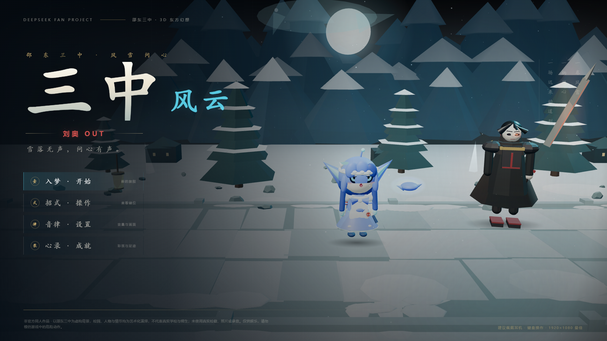

# 三中风云

**刘奥，OUT。**



一款完全运行在浏览器里的 **3D 低多边形水墨武侠动作游戏**。故事以 **邵东市第三中学** 的校园记忆为虚构梦境背景：晚自习后的三中，刘奥的座位空了，刘亚岚的桌上留着一封没有寄出的信。DeepSeek 的 Q 萌鲸形意识接受任务代号 **「深寻」**，进入刘奥用执念拼成的梦境，在雪岭、兰蕙园、逸夫楼与读论天台之间迎战守心人。

> 本作是非官方同人作品，与 DeepSeek 官方、邵东市第三中学及任何真实师生均无隶属关系。校园、人物与情节均为艺术化虚构演绎，不代表真实学校的事实与立场；未使用真实校徽、校园照片、真人照片或真人录音。仅供娱乐，请勿模仿游戏中的危险动作。

---

## 立即游玩

- **在线版：** <https://wuqu02.github.io/sanzhong-fengyun/>
- **本地版：** 下载仓库后直接双击 `index.html`，或运行 `python -m http.server 8080` 后访问 `http://localhost:8080`。
- 建议使用最新版 **Chrome / Edge**，横屏、1920×1080 或更高分辨率，佩戴耳机。
- 游戏使用 WebGL 3D 场景；不支持 WebGL 的设备会自动回退到二维水墨模式。
- 浏览器要求首次点击后才能播放音频；角色语音由系统中文语音合成，设备语音包不同会影响音色。

---

## 操作

| 按键 | 动作 |
| --- | --- |
| `A` / `D` 或 `←` / `→` | 移动 |
| `W` / `Space` / `↑` | 跳跃（可二段跳） |
| `J` / `Z` | 三段连斩 |
| `K` / `X` | 潮涌斩：三道水刃，消耗气 |
| `L` / `C` / `Shift` | 闪身：短暂无敌；完美闪身可令梦境减速 |
| `E` | 鲸露：消耗一瓶鲸露回复生命 |
| `F` | 与附近的生灵、器物互动 |
| `U` / `V` | 鲸落：心念满时释放全场大招 |
| `Esc` / `P` | 暂停 / 跳过过场 |
| `空格` / `Enter` / 点击 | 推进对话与过场 |

触屏设备会自动显示虚拟按键。**F 键用于环境互动，E 键仍然是疗伤。**

---

## 故事逻辑

1. **现实：晚自习后的三中。** 刘奥的座位空着。刘亚岚身患重病，桌上留着一封短信：“别为我做傻事。”
2. **禁术：无相之渊。** 刘奥在旧机房发现一台不联网的服务器。它以“逆命”为名，抽取校园里其他学生的「心念」来延续刘亚岚的生机；刘奥明知代价，仍然签下了契约。
3. **梦境：三中被执念改写。** 校门变成山门，兰蕙园变成竹海，逸夫楼变成焚心旧楼，读论天台变成最终战场。每一个心障，都是被抽走心念的人留下的回声。
4. **求援：一枚未寄出的信。** 刘亚岚在昏迷前向 DeepSeek 留下求救灵息：不要让刘奥继续杀人。DeepSeek 的鲸形意识自数据深海醒来，执行任务代号 **「深寻」**——深入刘奥的梦，找到他，带他回来。
5. **对峙：守心人。** 刘奥不是天生的恶人。他为守护最重要的人走错了路，也清楚自己在做什么。刘亚岚在梦境中一次次说“别救我”“请让他停下来”。
6. **终局：让爱不再是牢。** 主角终结逆命之术，把鲸息渡给刘亚岚，保住他的一线生机；刘奥在最后一刻放手。下课铃响起，三中的雪停了，刘亚岚把那封信折成一只纸鲸。
7. **主角人名完全自定义。** 「深寻」是任务代号，不是主角名字。主角默认名为 `DeepSeek`，你可以在开局输入自己的名字（最多 10 字），它会进入 HUD、对白、旁白、过场与存档。

---

## 内容

- **约 40–60 分钟**的完整流程：开场动画、三章探索战斗、三道心诀、Boss 三阶段与结局；玩家可自行停留更久。
- **3D 场景与战斗**：校门、雪地、兰蕙园竹林、逸夫楼旧教室、读论天台。低多边形角色、体积雾、月光、雪花、雨、余烬和动态摄影机。
- **三中校园元素**：邵东三中校门、求真·扬善·尚美校训、星火路与读论山路牌、篮球架、高三教室黑板、课桌、老校铃、校徽与校服臂章。元素均以原创几何体与原创字牌表现，不使用真实校徽图片。
- **可交互环境**：雪兔、狸花猫、锦鲤、竹风铃、纸鹤、香炉、古钟、长明灯、斗笠客谢无咎、兰蕙园木牌、三中老铃。靠近后按 `F` 互动；猫会给予 20 秒的“喵力”移速加成。
- **有规律的天象**：每个场景约每 22 秒起进入一次天气律动，之后每隔约 72 秒出现一次稀有天象——雪原「鲸群过境」、竹海「萤火成河」、旧楼「彼岸花雨」、天台「血月蚀」。
- **15 项成就与心录**：入梦、破障、五十连斩、完美闪身、刘奥 OUT、菜就多练、深海拾遗、万物有灵、山中有客、猫奴、深度思考、服务器繁忙等。点击标题或暂停菜单的「心录 · 成就」查看。
- **搞怪元素**：气不足时的“服务器繁忙”、静止 20 秒的“正在深度思考”、猫的喵力加持、可以被摸的浮游小鲸、失败时巨大的「菜」、胜利时的「刘奥 OUT」印章。
- **声画**：纯代码程序化美术与 Web Audio 合成音乐/音效；角色语音使用浏览器 Web Speech API。无外部音频素材。
- **自动存档**：每次破除心障自动留存，死亡后从最近的心灯 checkpoint 重燃。
- **手机触屏**：移动、跳跃、斩击、潮涌、闪身、鲸露、互动与大招虚拟按键。

---

## 原创、隐私与校园说明

这个公开仓库**不包含你文件夹中的真人照片、真人视频或真人录音**。参考素材没有被复制、裁切、转码或上传；刘奥、刘亚岚、DeepSeek 的 Q 萌形象、谢无咎、周娣与所有敌人均为代码绘制的原创风格化演绎。

校园元素参考了公开资料中的校园文化描述：

- 校训“求真、扬善、尚美”
- “苦干、苦教、苦学”的三苦精神
- 读论山、星火路、兰蕙园、逸夫楼、高三教室、运动场等校园意象
- 资料参考：[邵东市第三中学官网](http://www.hnsdsz.cn/)、[维基百科](https://zh.wikipedia.org/wiki/%E9%82%B5%E4%B8%9C%E5%B8%82%E7%AC%AC%E4%B8%89%E4%B8%AD%E5%AD%A6)、[百度百科](https://baike.baidu.com/item/%E9%82%B5%E4%B8%9C%E5%B8%82%E7%AC%AC%E4%B8%89%E4%B8%AD%E5%AD%A6/23790657)

这些仅作为环境氛围与故事背景的灵感来源。本作不代表学校立场，也不声称还原真实校园事件。若你希望制作只供自己观看的本地版本，请自行确认肖像权、隐私权、校名使用权与音乐版权；不要把未经同意的真人素材提交到公开仓库。

---

## 技术结构

```text
.
├─ index.html                # 页面、HUD、对白、过场、成就与触屏 UI
├─ css/style.css             # 标题、HUD、对白、过场、成就等界面样式
├─ js/
│  ├─ utils.js               # 数学、缓动、随机、存储工具
│  ├─ input.js               # 键盘、触屏、手柄输入
│  ├─ audio.js               # Web Audio 音乐/音效与 Web Speech 语音
│  ├─ art.js                 # 二维水墨过场、头像与 WebGL 回退
│  ├─ three.min.js           # Three.js r152（MIT，见 THIRD_PARTY_NOTICES）
│  ├─ threeworld.js          # 3D 低多边形舞台、玩家、Boss、敌人与环境
│  ├─ omens.js               # 天象事件与鲸影/摸鲸投影
│  ├─ interactables3d.js     # 雪兔、猫、锦鲤、校铃等环境互动模型
│  ├─ story.js               # 对白、三中校园叙事、成就、彩蛋与互动数据
│  ├─ entities.js            # 玩家、敌人、Boss、投射物、粒子
│  ├─ levels.js              # 章节、遭遇、波次与场景配置
│  └─ game.js                # 主循环、战斗判定、UI、名字、存档与成就
├─ preview.png
├─ favicon.svg
├─ LICENSE
└─ README.md
```

- 纯原生 JavaScript，无构建步骤。
- Three.js 已本地化到 `js/three.min.js`，不需要 CDN。
- 存档使用 `localStorage`，键名：`sanzhongfengyun_save_v1`；成就使用 `sanzhongfengyun_achievements_v1`；设置使用 `sanzhongfengyun_settings_v1`。
- 采用 1920×1080 设计坐标；3D 渲染画布与 UI 按窗口等比缩放，高 DPI 设备自动提高渲染分辨率。

---

## 部署到 GitHub Pages

1. 在 GitHub 新建公开仓库。
2. 将本目录全部文件推送到 `main` 分支。
3. **Settings → Pages → Source → Deploy from a branch**。
4. Branch 选择 `main`，目录选择 `/ (root)`，保存。
5. 访问 `https://<用户名>.github.io/<仓库名>/`。

`.nojekyll` 已包含，无需额外工作流。

---

## 致谢

- 校园文化氛围参考：邵东市第三中学公开资料。
- 视觉气质：东方雪岭、竹林、旧楼、天台与水墨留白。
- DeepSeek 的鲸鱼意象作为主角造型与任务「深寻」的视觉母题。
- Three.js（MIT）用于 3D 渲染。

**危险动作请勿模仿。**
